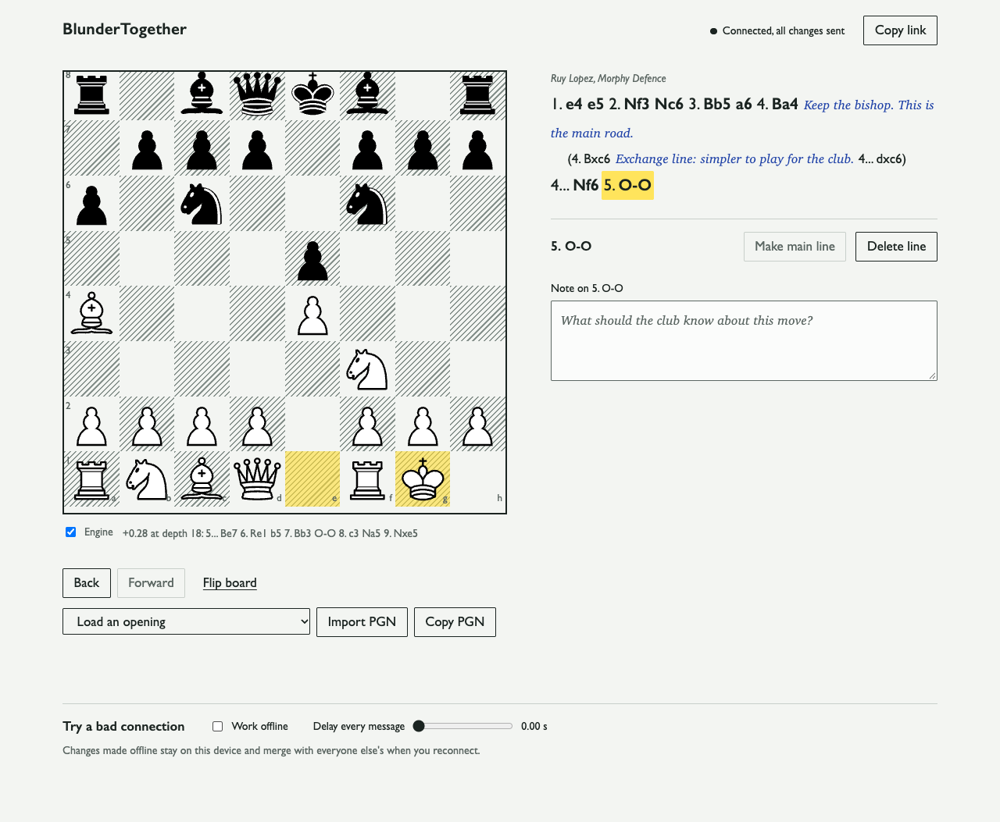
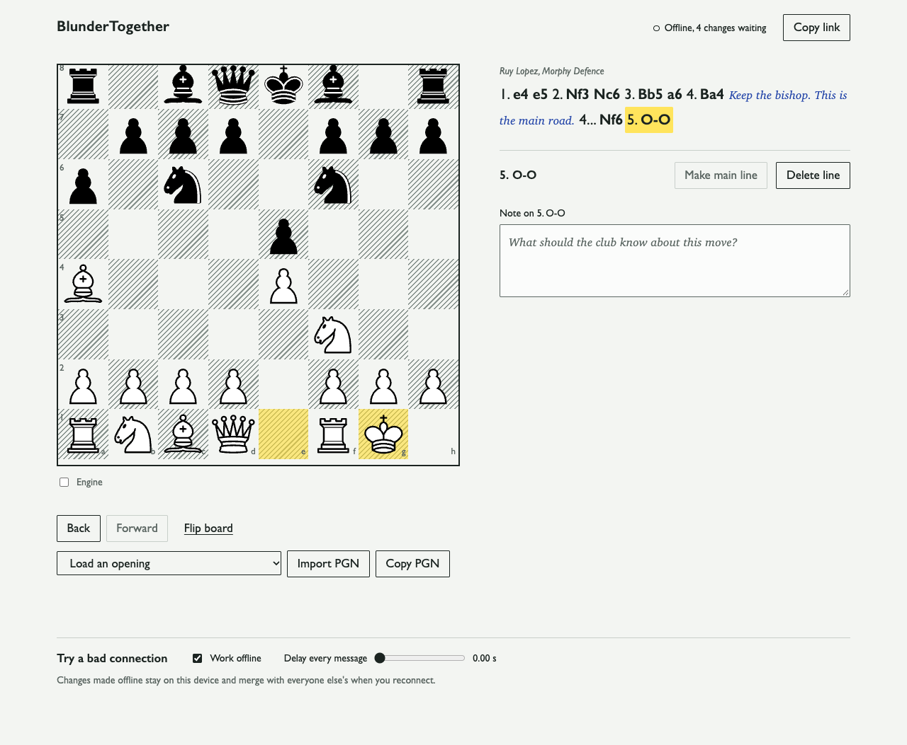
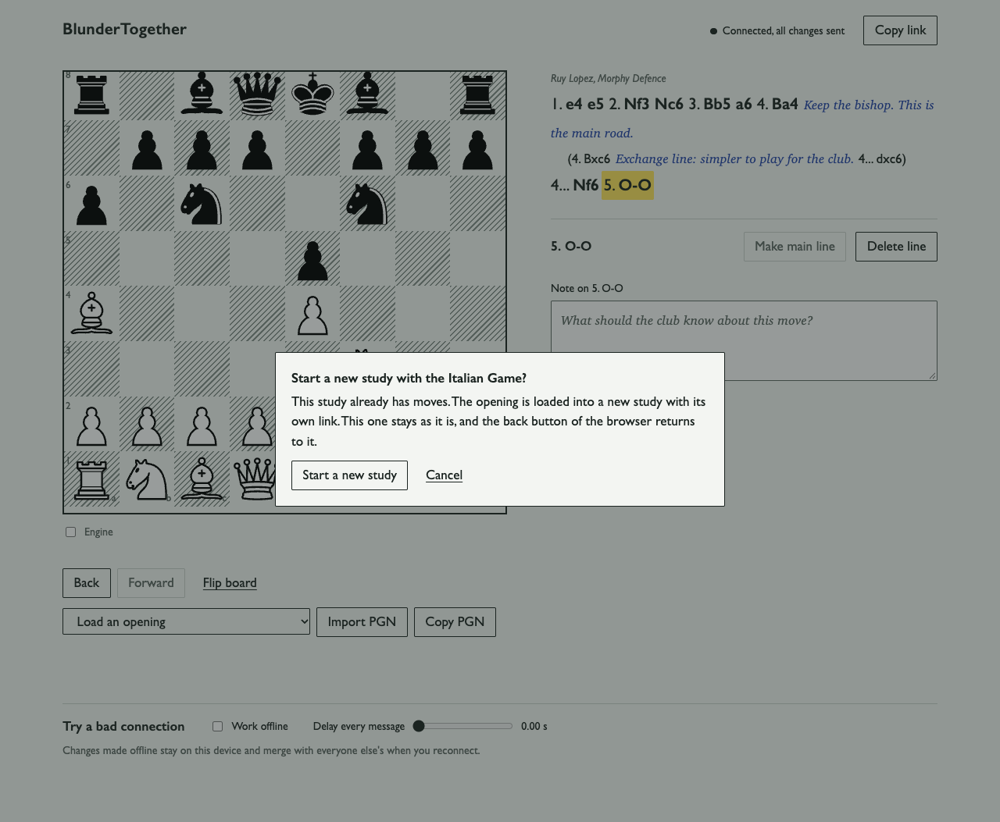

# BlunderTogether

Local-first collaborative chess analysis with a Go sync server.



I have been passionate about chess for a long time: playing with my friends,
watching videos and always trying to get better. When I joined the Edinburgh
chess club, I had an idea. I wanted to load our games and replay them with
my friends, trying different scenarios together. But what if one of us has
bad internet?

That question became this project: a shared chess study that never loses
anyone's moves, even when two people change the same position at the same
time without a connection.

Several people open the same link and add moves, variations and notes. The
app works fully offline. When the devices reconnect, all of them end up with
the same analysis tree, whoever was offline and for however long.

A study can start from a named opening or from a pasted PGN game, and can be
copied out as PGN. The name of the opening is shown above the moves.

It is not peer-to-peer: a small server stores the changes and passes them
on. The server never decides who wins a conflict. All merging happens in a
CRDT of about 300 lines that runs in each browser.

## What it looks like

**Working offline.** I switched the connection off and played three moves
with a note. The changes are saved on the device and wait there.



**After reconnecting.** A second person was offline too and played a
different fourth move with their own note. Both lines are in the study now
(the picture at the top), and both people see exactly the same tree. The
line under the board is Stockfish running in the browser.

**Loading into a study that already has moves.** The app asks first and then
opens a new study with its own link, so nobody's work is mixed up or hidden.



## How it works

```
 browser A                         Go server                       browser B
+--------------------+        +------------------+        +--------------------+
| React app          |        | one goroutine    |        | React app          |
| CRDT core (state)  |<-ws--->| per room         |<-ws--->| CRDT core (state)  |
| IndexedDB: log,    |  JSON  | SQLite: append-  |  JSON  | IndexedDB: log,    |
| outbox, cursor     |        | only log per room|        | outbox, cursor     |
| Stockfish (worker) |        +------------------+        | Stockfish (worker) |
+--------------------+                                    +--------------------+
```

- Every edit is an operation: `addMove`, `setMainline`, `setDeleted` or
  `setComment`. It is saved on the device first, then applied, then sent.
- A move's id is a hash of its parent's id and the move, so two people who
  play the same move offline create the same id and the copies merge.
- The other three operations are last-writer-wins by Lamport timestamp.
- The server gives each operation a sequence number in its room. A client
  catches up by asking for everything after the last number it saw.
- Delivery is at-least-once. Applying an operation twice changes nothing, so
  duplicates are harmless.
- The visible tree is computed from the state and never stored. Where nobody
  chose a main line, the move that was added first comes first.

## What happens on conflict

| Concurrent actions                                     | Outcome on every device                                               |
| ------------------------------------------------------ | --------------------------------------------------------------------- |
| A and B both play `e4` from the same position          | One move                                                              |
| A deletes a line, B extends it offline                 | The whole line is hidden, B's moves included. Restoring it shows them |
| A and B promote different variations                   | The promotion with the larger timestamp wins                          |
| A and B edit the same note                             | The edit with the larger timestamp wins; the other is lost            |
| Main line points to a deleted or not-yet-received move | Ignored; the move that was added first stays in front                 |
| The same operation arrives three times                 | Applied once in effect                                                |

## Run it

Needs Node 20.19 or newer and Go 1.26.

```sh
npm install
(cd server && go run . -db dev.db)      # sync server on :8080
npm run dev --workspace web             # app on http://localhost:5173
```

Open the app, copy the link, and open it in a second browser profile. Use
"Work offline" in both, edit the same position differently, then reconnect.

A second demo of the same idea: in a new, empty study, go offline in both
profiles, load the same opening in both, reconnect. The study holds the line
once, not twice.

Or as one container:

```sh
docker build -t blundertogether .
docker run -p 8080:8080 -v blunder-data:/data blundertogether
```

## Tests

| Command                            | What it checks                                                                                                                                             |
| ---------------------------------- | ---------------------------------------------------------------------------------------------------------------------------------------------------------- |
| `npm run check`                    | Lint, formatting, types, unit tests for the CRDT and the client                                                                                            |
| `npm run test:sim`                 | 5 replicas, 200 random operations, 1,000 seeds; the network delays, reorders, duplicates and partitions, and replicas restart. All replicas must end equal |
| `npm run test:e2e`                 | The real server binary with headless clients: convergence, late join, restart, a crash between commit and acknowledgement, protocol errors                 |
| `cd server && go test -race ./...` | Server behaviour with real WebSocket clients under the race detector                                                                                       |

The simulation also runs two deliberately broken versions of the system and
fails if it does not catch them. A failing seed reproduces the exact run:
`SIM_SEED=32 npm run test:sim`. See `docs/DESIGN.md`.

## Measurements

Produced by `npm run bench` on an Apple M1 Pro with Node 20.19.5, server and
client on the same machine.

| Measurement                                                        | Result                           |
| ------------------------------------------------------------------ | -------------------------------- |
| Store 10,000 operations in pushes of 200                           | 104 ms                           |
| New client catches up on a room of 10,000 operations (median of 5) | 15 ms                            |
| Size of that catch-up                                              | 1.46 MB, 146 bytes per operation |
| Simulation, 1,000 runs                                             | 1.85 s                           |
| Simulation, operations created per second                          | about 108,000                    |

There is no network between client and server in these numbers, so they
show the cost of the code, not of a real connection.


## Layout

| Folder      | Holds                                                     |
| ----------- | --------------------------------------------------------- |
| `core/src/` | The CRDT and its unit tests. No React, network or storage |
| `core/sim/` | Seeded convergence simulation                             |
| `web/`      | React app, IndexedDB store, sync client, engine worker    |
| `server/`   | Go sync server                                            |
| `e2e/`      | End-to-end tests and the benchmark                        |
| `testdata/` | JSON test vectors                                         |
| `docs/`     | Protocol, contracts, design notes with review questions   |

## Licence

MIT, see `LICENSE`. The engine has its own licence, see below.

## Third-party software

The engine is [Stockfish](https://stockfishchess.org), built for the web by
the [stockfish.js](https://github.com/nmrugg/stockfish.js) project and
licensed under GPL-3.0. It is not stored in this repository; the build copies
it from the npm package and ships its licence next to it. It runs as a
separate program in a Web Worker and talks to the app in UCI text.
